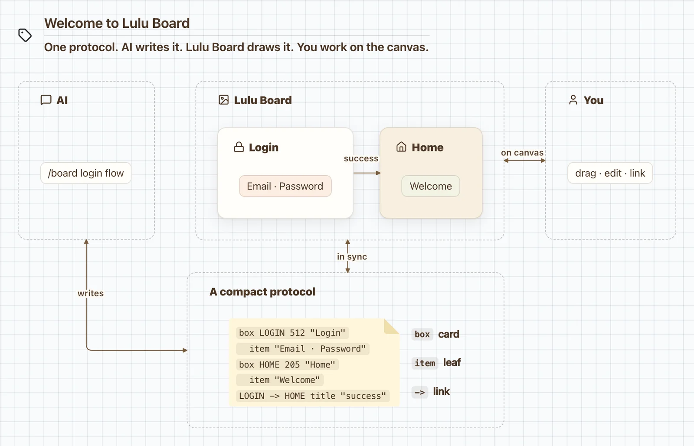
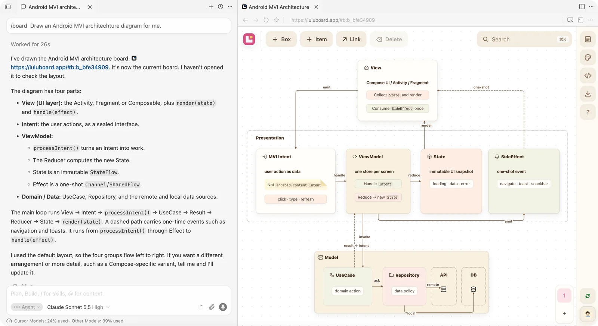
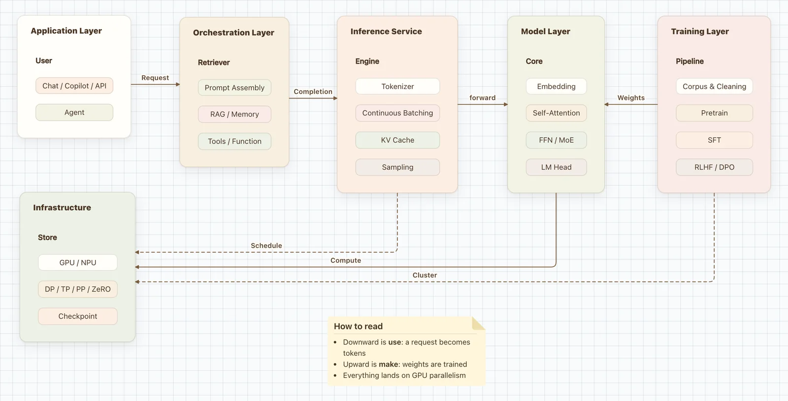

<p align="center">
  
</p>

<h1 align="center">Lulu Board</h1>

<p align="center"><b>Structured whiteboard. A way to collaborate visually with AI.</b></p>

<p align="center">
  <a href="https://luluboard.app/">luluboard.app</a>
  &nbsp;
  <a href="LICENSE"></a>
</p>

---

One text protocol — the AI agent writes it, Lulu Board draws it, you work on the canvas; both stay in sync. A local loop.

| Kind | In Lulu Board |
|---|---|
| Sketch | one picture on the public viewer |
| Boxes | structured whiteboard text |
| Mermaid | open catalog types |

## Why

Diagrams go stale when only one side can edit them. Lulu Board keeps one text protocol as the source of truth: the agent writes it, you refine it on the canvas (or in Source), and both stay in sync.

## Quick start

Chat entry is [`/boxes`](./skills/boxes/SKILL.md):

```text
/boxes
```

The Drawer opens on a built-in template — the onboarding diagram — so you can see the loop right away:

<p align="center">
  <a href="./examples/board-onboarding/onboarding.bmd">
    
  </a>
</p>

<p align="center"><strong>Onboarding</strong> — AI writes. Lulu Board draws. You work on the canvas.</p>

**Source** (`<>`) → **History** to browse the built-in templates. New files are stored there too.

## Draw from a prompt

Describe what you want after `/boxes`:

```text
/boxes Draw an Android MVI architecture diagram for me.
```

The agent authors the source and opens the Drawer. From there you can drag and edit on the canvas, change Source by hand, or ask again — same document, shared with the agent.

A signed-in owner can share a saved cloud diagram from the Share dock. The first audience is All, with View or Edit. Anyone with the `#s:` link can open the current diagram; Edit lets a signed-in visitor change that same row.

<p align="center">
  <a href="./examples/board-android-mvi/android-mvi-architecture.bmd">
    
  </a>
</p>

<p align="center"><strong>Diagram · Android MVI</strong> — ask in chat, see it in Drawer, edit on canvas or in Source</p>

## MCP configuration

`/boxes` works without MCP: the agent opens an unsigned `#z:` link. To create and update the latest cloud diagram for your account, add the hosted MCP and Connect.

```json
{
  "mcpServers": {
    "lulu-board": {
      "url": "https://mcp.luluboard.app/mcp"
    }
  }
}
```

In Cursor, open **Settings → Tools & MCP**. Add that URL if `lulu-board` is not listed, then **Connect** and approve sign-in. After `whoami` returns an account, `/boxes` writes `https://preview.luluboard.app/#b:…` instead of `#z:`. If `whoami` is listed but the call fails, `/boxes` still writes `#z:`.

Other MCP clients use the same URL — for Claude Code: `claude mcp add --transport http lulu-board https://mcp.luluboard.app/mcp`. The first call opens a Lulu Board sign-in and consent page.

## Examples

Click a preview to open the source.

### Board

<table>
  <tr>
    <td valign="top" align="center">
      <a href="./examples/board-llm-architecture/llm-architecture.bmd">
        
      </a>
      <p>
        <strong>LLM Architecture</strong><br />
        Agent stack from data through training
      </p>
    </td>
  </tr>
</table>

## Skill

Chat entry is `/boxes`.

```text
skills/
  scripts/   # short_link
  test/
  boxes/     # SKILL.md, scripts/, templates/
  sketch/
  mermaid/
```

## Develop

```text
examples/    # README previews (source) → packed into skills/boxes/templates
packages/    # board, drawer-app, board-mcp
scripts/     # build tooling
skills/     # /boxes /sketch /mermaid
tests/
.cache/web/  # generated public viewer
```

From the repo root:

```bash
npm run build
```

## License

- Project: [MIT](./LICENSE)
- Vendored: [THIRD_PARTY.md](./THIRD_PARTY.md)
