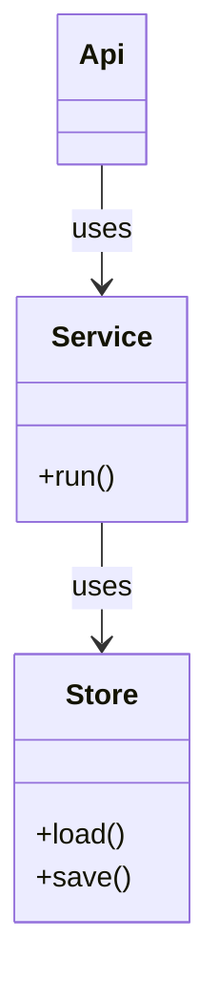
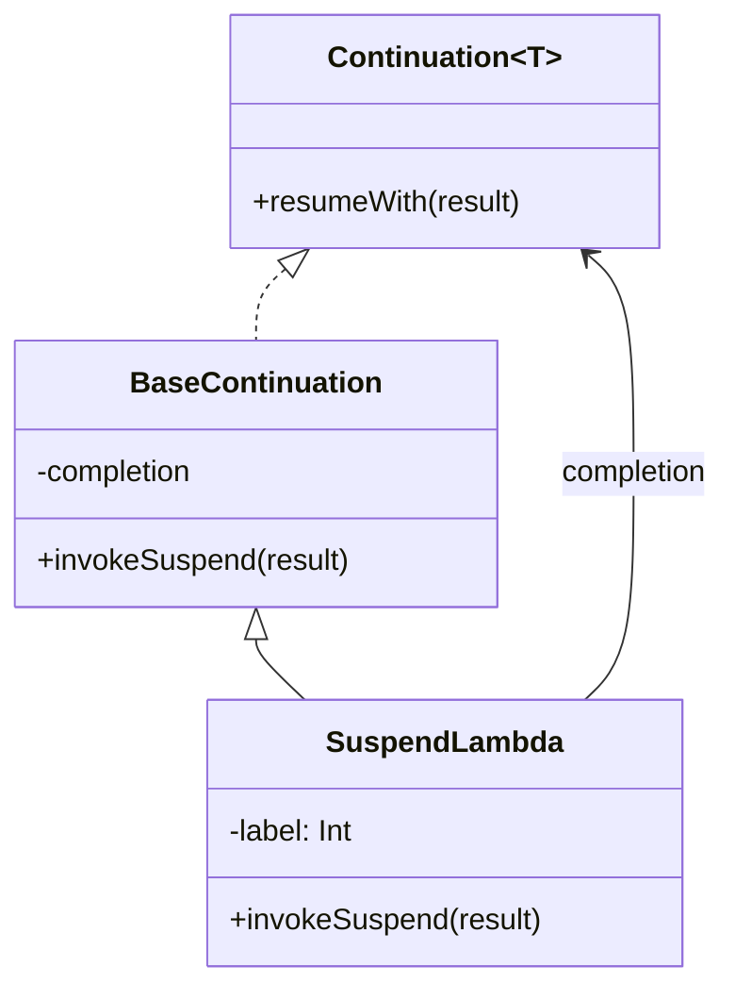

# class

Keyword: `classDiagram` (also `classDiagram-v2`).
Invariant: types and structural relations. Not runtime steps.

Drawer renders through Pele. Properties edit Title. Source edits the body.

## minimal

## rich

