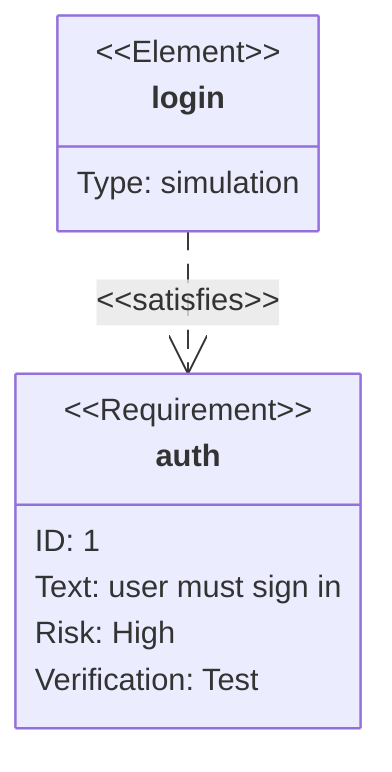

# requirement

Keyword: `requirementDiagram` (also `requirement`).
Invariant: requirements, elements, and satisfy/verify links.

Drawer renders through Pele. Properties edit Title. Source edits the body.

## minimal

