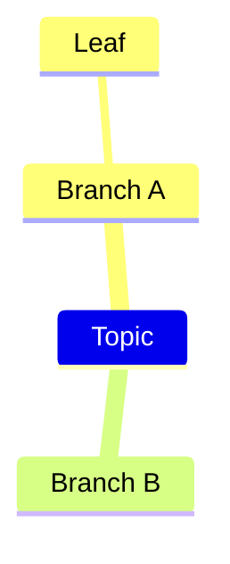

# mindmap

Keyword: `mindmap`.
Invariant: one root, indented branches. Not a flowchart.

Drawer draws every node as the same soft pill; Topic (root) is larger.
Shape markers like `((Topic))` are accepted on parse but not used for rendering,
and edits serialize plain labels only.

## Drawer chrome

1. Layout is Radial or Logic in Properties. Persist `mindmapLayout` in chrome.
   Do not invent source syntax for layout.
2. Toolbar: Root, Node, Delete. Root is disabled when a root exists. Root
   cannot be deleted.
3. Node and hover `+` add a child. Selected Node adds under that topic;
   otherwise under the root.
4. Do not author connection text.

## minimal

